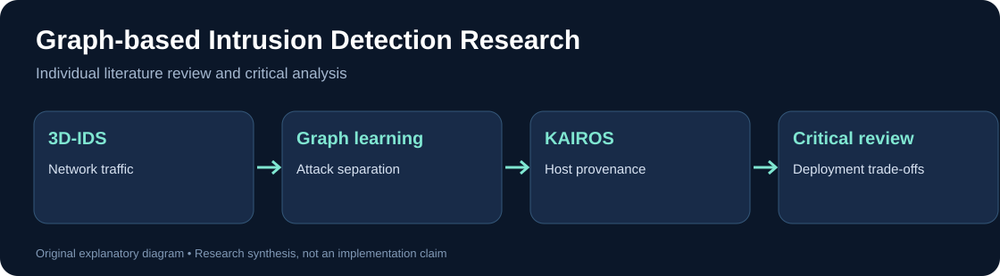
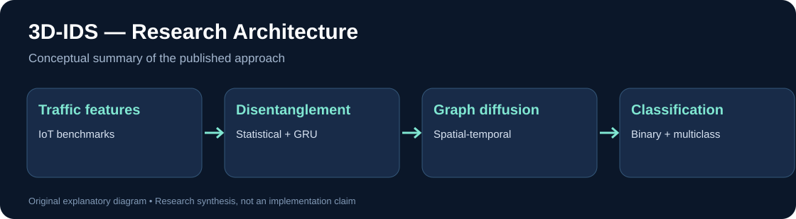
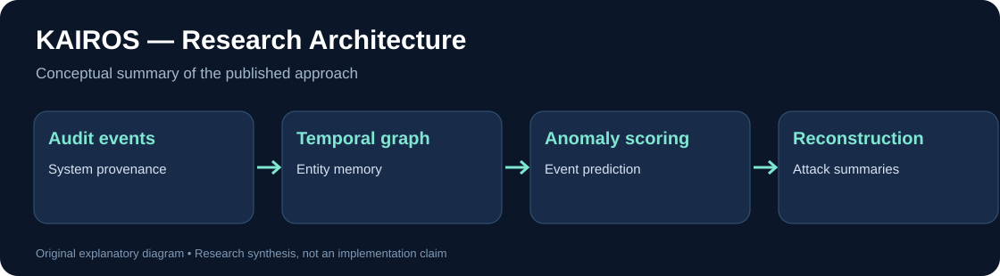

# 🛡️ Deep Learning for Intrusion Detection
### Individual Research & Critical Analysis | 3D-IDS and KAIROS

**Graph-Based Deep Learning | Intrusion Detection | Cybersecurity Research**


**Research by Fairouz Abdulrahman Hamed Mousa**

**BSc (Hons) Computer Science (Cyber Security)**  
**Asia Pacific University of Technology & Innovation | 2026**

---

## 📌 Project Overview

This repository presents my individual research and critical analysis of two advanced graph-based intrusion detection approaches:

1. **3D-IDS — Doubly Disentangled Dynamic Intrusion Detection**
2. **KAIROS — Practical Intrusion Detection and Investigation with Whole-System Provenance**

The research explores how graph-based deep learning techniques can improve the detection of sophisticated cyberattacks, identify abnormal system behavior, and support security investigations.

My analysis focuses on the architectural design, methodologies, published experimental findings, advantages, limitations, and practical cybersecurity applications of both approaches.

This work was completed as my individual research contribution to a broader academic assignment in Deep Learning for Intrusion Detection.

**Research Integrity:** The intrusion detection systems discussed were developed by their respective research authors. My contribution consists of independent literature analysis, technical evaluation, and comparison rather than implementation of these systems.

---

## 🖥️ Research Overview



### 🎯 Research Objectives

- Investigate advanced graph-based intrusion detection techniques.
- Examine deep learning approaches for detecting complex cyberattacks.
- Understand the role of temporal and spatial relationships in security analysis.
- Evaluate intrusion detection performance using published experimental findings.
- Compare network-based and host-based intrusion detection methodologies.
- Identify practical challenges affecting real-world deployment.
- Critically assess the strengths and limitations of existing research.

---

## 🔐 Research Study 1: 3D-IDS

### Doubly Disentangled Dynamic Intrusion Detection

**Research Paper:** Qiu et al. (2023)

### 📖 Background

Traditional intrusion detection systems may struggle to distinguish different attack categories when their network traffic features overlap.

This challenge can reduce classification accuracy, particularly when detecting sophisticated or previously unseen attacks.

3D-IDS addresses this problem through a graph-based deep learning framework that combines statistical disentanglement, representational disentanglement, and dynamic graph diffusion.

### 🏗️ Architecture and Methodology



The framework incorporates several techniques:

| Component | Purpose |
|-----------|---------|
| Statistical Disentanglement | Reduces statistical dependencies between overlapping traffic characteristics. |
| Representational Disentanglement | Learns more distinguishable attack representations using GRU-based memory and regularization. |
| Dynamic Graph Diffusion | Captures spatial and temporal relationships within network traffic. |
| Two-Stage Classification | Supports binary intrusion detection and multiclass attack classification. |

### ⚙️ Technical Approach

**1. Statistical Disentanglement**

The framework uses non-parametric mutual information optimization formulated as a Satisfiability Modulo Theories (SMT) problem.

This helps reduce dependencies between overlapping attack representations.

**2. Representational Disentanglement**

GRU-based memory and near-orthogonality regularization are used to improve feature representation.

**3. Dynamic Graph Diffusion**

Graph-based diffusion captures complex spatial and temporal traffic relationships.

**4. Intrusion Classification**

The framework supports both binary detection and multiclass classification of network attacks.

### 📊 Published Experimental Findings

| Evaluation Metric | Reported Result |
|-------------------|-----------------|
| F1 Score on CIC-BoT-IoT | 98.24% |
| Improvement Over Earlier Record | 4.80 percentage points |
| Mean F1 for Unknown-Attack Detection | 33.65% |
| AUC Reduction Without Graph Diffusion | 18.33 points |

**Note:** These results were reported by the original researchers and summarized in my academic analysis. I did not independently reproduce these experiments.

### 🔍 My Critical Evaluation

**Strengths**

- Addresses overlapping attack representations.
- Combines multiple advanced deep learning techniques.
- Captures spatial and temporal network relationships.
- Demonstrates strong reported performance on evaluated benchmarks.
- Provides a structured approach to network attack classification.

**Limitations**

- Computational requirements may restrict deployment on resource-constrained systems.
- Generalization beyond IoT-oriented datasets remains uncertain.
- Unknown-attack detection performance remains a challenge.
- Operational explainability requires further investigation.
- Performance in changing real-world environments requires additional validation.

### 💡 Research Insight

My analysis identified disentanglement as an important technique for improving the separation of complex network attack patterns.

However, high benchmark accuracy does not automatically guarantee reliable intrusion detection in operational environments.

Practical deployment must also consider computational efficiency, generalization, and previously unseen threats.

---

## 🛡️ Research Study 2: KAIROS

### Practical Intrusion Detection and Investigation with Whole-System Provenance

**Research Paper:** Cheng et al. (2024)

### 📖 Background

Advanced Persistent Threats (APTs) often involve multiple stages and can remain undetected by blending malicious actions with legitimate system activities.

Traditional intrusion detection methods may struggle to connect individual events into a meaningful attack sequence.

KAIROS addresses this challenge using whole-system provenance analysis and temporal graph learning.

### 🏗️ Architecture and Methodology



KAIROS examines system audit events and constructs dynamic provenance graphs to identify anomalous behavior.

| Component | Purpose |
|-----------|---------|
| System Audit Provenance | Represents relationships between processes, files, and system activities. |
| Temporal Graph Network | Learns evolving relationships between system entities. |
| Event Prediction | Detects anomalous activity using reconstruction errors. |
| Attack Reconstruction | Produces compact graph summaries to support investigations. |

### ⚙️ Technical Approach

**1. System Event Collection**

KAIROS processes audit events representing interactions between system entities.

**2. Provenance Graph Construction**

System activities are represented as graph relationships, helping preserve the context of events.

**3. Temporal Graph Learning**

A Temporal Graph Network learns patterns of normal system behavior over time.

**4. Anomaly Detection**

An MLP decoder and reconstruction-error mechanism help identify suspicious events.

**5. Attack Reconstruction**

Detected anomalies are organized into compact investigation graphs, reducing the volume of information analysts must review.

### 📊 Published Experimental Findings

| Evaluation Metric | Reported Result |
|-------------------|-----------------|
| Recall on Evaluated DARPA Datasets | 100% |
| False-Positive Rate | 3.27% |
| MLP Baseline False-Positive Rate | 16.82% |
| Processing Throughput | Approximately 11,000 events/second |
| Example Investigation Reduction | 3.4 million edges to 31 |

In the documented E3-THEIA example, the reduction was described as reaching approximately 109,469 times.

**Note:** These are findings from the published research, not results obtained through my own implementation.

### 🔍 My Critical Evaluation

**Strengths**

- Supports detection of suspicious system behavior.
- Uses temporal graph learning to preserve event relationships.
- Reduces dependence on labeled attack data through benign-behavior learning.
- Provides attack reconstruction to assist security investigations.
- Demonstrates promising published detection and processing performance.

**Limitations**

- Performance may degrade when normal system behavior changes.
- Benchmark attacks may not fully represent real-world adversarial techniques.
- Legitimate administrative tools used maliciously can complicate detection.
- Provenance processing may introduce operational resource requirements.
- Continuous adaptation may be necessary to address concept drift.

### 💡 Research Insight

My analysis highlighted the importance of combining intrusion detection with investigation capabilities.

Rather than only identifying anomalous activity, KAIROS attempts to reconstruct relevant event relationships.

This approach may help security analysts understand complex attacks and reduce investigation workload.

---

## ⚖️ Comparative Analysis: 3D-IDS vs KAIROS

| Evaluation Area | 3D-IDS | KAIROS |
|-----------------|--------|--------|
| Primary Focus | Network intrusion detection | Host-level intrusion detection and investigation |
| Data Source | Network and IoT traffic | System audit events |
| Deep Learning Approach | Disentanglement and dynamic graph diffusion | Temporal Graph Network |
| Detection Strategy | Traffic representation and classification | Behavioral anomaly detection |
| Main Objective | Improve attack classification | Detect anomalies and reconstruct attack activity |
| Investigation Support | Classification-oriented findings | Compact attack reconstruction graphs |
| Main Challenge | Computational cost and generalization | Concept drift and stealthy activity |

### Key Research Observations

Both approaches demonstrate the growing importance of graph-based learning in cybersecurity.

However, they address different security challenges.

**3D-IDS** focuses primarily on improving network attack representation and classification.

**KAIROS** focuses on identifying suspicious host-level activity and supporting the investigation process.

Their different approaches illustrate how graph-based deep learning can be applied across multiple intrusion detection environments.

---

## 🧠 Cybersecurity Concepts Explored

### Graph-Based Deep Learning

Graph-based learning models relationships between entities rather than treating all observations independently.

This is particularly relevant in cybersecurity because malicious activities frequently involve connected events.

### Temporal Analysis

Temporal modeling captures how activities evolve over time.

It can help identify suspicious patterns that may not be visible when analyzing isolated events.

### Anomaly Detection

Anomaly detection identifies behavior that differs from learned normal patterns.

It can support the identification of previously unknown threats, although false positives and changing environments remain important challenges.

### Intrusion Detection and Investigation

Effective cybersecurity monitoring requires more than generating alerts.

Security analysts also need sufficient context to understand suspicious behavior, evaluate potential impact, and prioritize investigation.

---

## 📊 Research Findings and Discussion

My research identified several important considerations for applying deep learning to intrusion detection.

### Detection Performance

Published benchmark results demonstrate the potential of graph-based approaches for identifying complex security threats.

However, evaluation metrics must be interpreted in relation to the datasets, attack scenarios, and experimental conditions used.

### Generalization

Models trained and evaluated using specific datasets may perform differently in other network or system environments.

### Computational Efficiency

Advanced graph-based architectures may require significant processing resources.

This creates potential deployment challenges in environments with limited hardware capacity.

### Explainability

Security analysts benefit from detection systems that provide understandable explanations and relevant investigation context.

### Concept Drift

Changes in legitimate network or system behavior can affect the reliability of learned detection models.

These considerations are important when evaluating the suitability of research approaches for operational cybersecurity systems.

---

## 🛠️ Technologies and Concepts Studied

| Category | Technologies / Concepts |
|----------|-------------------------|
| Cybersecurity | Intrusion Detection Systems, APT Detection |
| Artificial Intelligence | Deep Learning |
| Graph Learning | Graph-Based Neural Networks |
| Temporal Modeling | Temporal Graph Networks, GRU |
| Network Security | Network Traffic Analysis |
| Host Security | System Audit and Provenance Analysis |
| Detection Methods | Anomaly Detection, Binary and Multiclass Classification |
| Evaluation | F1 Score, Recall, AUC, False-Positive Rate |
| Research Methods | Literature Review, Comparative Analysis, Critical Evaluation |

These technologies and methods were studied and evaluated through academic research. Their inclusion does not imply that I independently implemented every technique.

---

## 📁 Repository Structure

```text
Deep-Learning-Intrusion-Detection-Research/
│
├── README.md
│
├── research-overview.svg
│
├── 3d-ids-analysis.svg
│
├── kairos-analysis.svg
│
└── CONTRIBUTION_AND_SOURCES.md
```

The three SVG files are original explanatory diagrams created to illustrate the research analysis.

This repository is intended as a research portfolio and does not contain a runnable intrusion detection implementation.

---

## 🎓 Individual Research Contribution

This repository showcases my individual academic contribution to a broader group assignment.

My work focused specifically on:

- Researching the 3D-IDS intrusion detection approach.
- Analyzing its architecture and underlying methodology.
- Evaluating its published experimental findings.
- Identifying its technical strengths and limitations.
- Researching the KAIROS intrusion detection framework.
- Examining temporal provenance graph analysis.
- Evaluating its anomaly detection and investigation capabilities.
- Comparing the two approaches from a cybersecurity perspective.
- Developing critical observations about their practical applicability.

**Academic Attribution:** The underlying intrusion detection systems and published experimental results belong to their original research authors. The wider group assignment included collaborative components that are not claimed as my individual work.

---

## 📚 References

**1. Qiu et al. (2023)**  
*3D-IDS — Doubly Disentangled Dynamic Intrusion Detection.*

**2. Cheng et al. (2024)**  
*KAIROS: Practical Intrusion Detection and Investigation with Whole-System Provenance.*

The research findings presented in this repository are attributed to their respective authors.

Complete bibliographic details should be verified against the original papers and academic report.

---

## 🚀 Future Research Directions

Potential areas for further investigation include:

- Improving detection of previously unseen cyberattacks.
- Evaluating graph-based intrusion detection in enterprise networks.
- Exploring lightweight deep learning architectures.
- Improving model explainability for security analysts.
- Addressing concept drift in evolving environments.
- Combining network-based and host-based detection.
- Investigating real-time detection and automated incident analysis.

---

## 🎓 Academic Information

**Research Title:** Deep Learning for Intrusion Detection — Individual Research and Critical Analysis

**Researcher:** Fairouz Abdulrahman Hamed Mousa

**Degree:** BSc (Hons) Computer Science (Cyber Security)

**Institution:** Asia Pacific University of Technology & Innovation (APU), Malaysia

**Module:** CT115-3-3-DLI — Deep Learning for Intrusion Detection

**Year:** 2026

---

## 🎯 Research Contribution Summary

This research strengthened my understanding of advanced intrusion detection techniques and the application of graph-based deep learning in cybersecurity.

Through the technical evaluation of 3D-IDS and KAIROS, I examined how different architectures address network-level and host-level security threats.

The research also emphasized the importance of considering real-world deployment challenges, detection reliability, computational efficiency, and explainability when assessing AI-driven cybersecurity solutions.

---

### 🛡️ Deep Learning for Intrusion Detection

**Exploring Graph-Based Deep Learning for Advanced Cyber Threat Detection and Investigation.**

*Individual academic research contribution | Asia Pacific University of Technology & Innovation | 2026*
